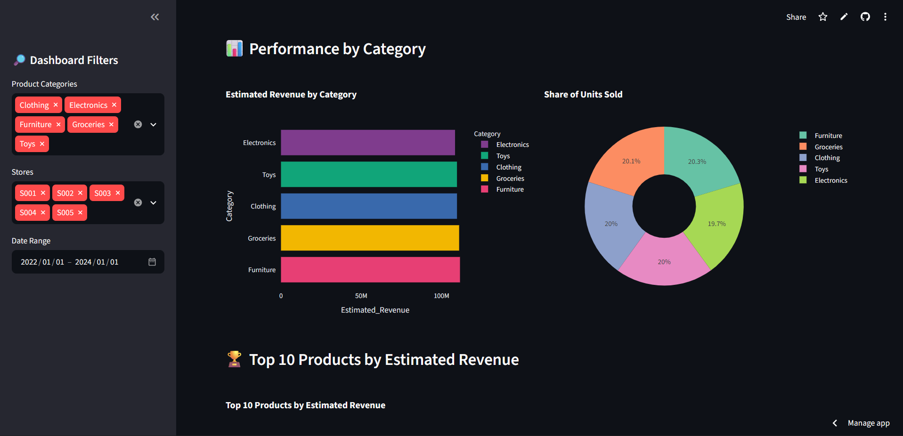

# 📦 Optimisation des stocks dans le commerce de détail

### Un tableau de bord interactif pour l'analyse des ventes, la prévision de la demande et la gestion des risques liés aux stocks

## 📌 Présentation du projet

Les entreprises de distribution doivent maintenir des niveaux de stock suffisants pour répondre à la demande des clients tout en limitant les surstocks, les ruptures de stock et les coûts de stockage.

Ce projet consiste à exploiter des données de vente et de gestion des stocks afin de produire des indicateurs de performance, d'analyser les écarts entre les ventes et la demande prévue et de repérer les situations pouvant présenter un risque pour la disponibilité des produits.

Une application interactive développée avec Streamlit permet de visualiser les principaux indicateurs et de faciliter l'exploration des données pour soutenir la prise de décision.

## 🎯 Objectifs du projet

- Analyser les performances commerciales par catégorie de produits, magasin et référence.
- Suivre les niveaux de stock et le chiffre d'affaires estimé.
- Évaluer les écarts entre les ventes observées et les prévisions de demande.
- Repérer les situations pouvant indiquer un risque de rupture ou de surstock.
- Concevoir un tableau de bord interactif pour le suivi des performances.
- Fournir des informations utiles à la planification des approvisionnements et à la prise de décision.

## 📊 Présentation du jeu de données

Le projet utilise le jeu de données **Retail Store Inventory Forecasting Dataset**, disponible sur Kaggle.

- **Source :** [Retail Store Inventory Forecasting Dataset](https://www.kaggle.com/datasets/anirudhchauhan/retail-store-inventory-forecasting-dataset)
- **Nombre d'observations :** 73 100
- **Nombre de variables :** 15
- **Périmètre :** 5 magasins et 20 produits
- **Fréquence :** données quotidiennes de vente et de stock

Les principales variables concernent les dates, les magasins, les produits, les catégories, les régions, les niveaux de stock, les quantités vendues, les quantités commandées, les prévisions de demande, les prix, les remises, les promotions, les conditions météorologiques, les prix des concurrents et la saisonnalité.

*Remarque : le jeu de données est synthétique et est utilisé à des fins d'analyse, d'apprentissage et de démonstration.*

## 🛠️ Outils et technologies

- **Python :** programmation et analyse des données.
- **Pandas :** nettoyage, transformation et agrégation des données.
- **Plotly :** création de visualisations interactives.
- **Streamlit :** développement du tableau de bord.
- **Google Colab :** exploration des données et développement.
- **GitHub :** gestion du code source et documentation.
- **Streamlit Community Cloud :** déploiement de l'application en ligne.

## 🔍 Démarche d'analyse

Le travail réalisé comprend les étapes suivantes :

1. Vérification de la qualité des données : valeurs manquantes, doublons et validité des dates.
2. Création d'indicateurs dérivés pour mesurer les ventes et le chiffre d'affaires estimé.
3. Calcul de l'erreur absolue entre les quantités vendues et les prévisions de demande.
4. Construction d'un indicateur exploratoire de couverture du stock par rapport à la demande prévue.
5. Comparaison des performances entre catégories et produits.
6. Repérage préliminaire des observations pouvant signaler des risques de rupture ou de surstock.
7. Restitution des résultats dans un tableau de bord interactif.

## 📈 Indicateurs clés

| Indicateur | Description |
|---|---|
| Quantités vendues | Volume total des ventes sur la période sélectionnée |
| Chiffre d'affaires estimé | Quantités vendues multipliées par le prix unitaire |
| Stock moyen | Niveau moyen du stock enregistré |
| Erreur absolue moyenne de prévision | Écart absolu moyen entre les quantités vendues et la demande prévue |
| Risque potentiel de rupture | Observation présentant moins d'une journée de demande prévue en stock |
| Surstock potentiel | Observation présentant plus de trois jours de demande prévue en stock |

Les seuils de couverture utilisés pour le repérage des risques sont illustratifs et ne constituent pas des normes opérationnelles validées. L'erreur de prévision calculée compare les ventes enregistrées aux prévisions disponibles ; elle ne suffit pas, à elle seule, à établir la précision des prévisions de demande future.

## 🖥️ Fonctionnalités du tableau de bord

L'application permet de :

- **Filtrer les données** par catégorie de produits, magasin et période.
- **Suivre les indicateurs clés** : quantités vendues, chiffre d'affaires estimé, stock moyen et erreur moyenne de prévision.
- **Comparer les catégories** selon le chiffre d'affaires et les volumes vendus.
- **Identifier les produits les plus performants** à partir du chiffre d'affaires estimé.
- **Analyser la couverture des stocks** par catégorie.
- **Visualiser les risques potentiels** de rupture et de surstock.
- **Consulter les données détaillées** dans un tableau interactif.
- **Télécharger les données filtrées** au format CSV pour des analyses complémentaires.

## 📸 Aperçu du tableau de bord



## 🚀 Accéder à l'application

Le tableau de bord est accessible en ligne :

👉 **[Lancer le tableau de bord interactif](https://retail-inventory-optimization-egjzo4vvqsdx42qkvpuycb.streamlit.app/)**

## 📁 Structure du projet

```text
retail-inventory-optimization/
│
├── app.py
├── retail_inventory.csv
├── requirements.txt
├── README.md
└── images/
    └── dashboard.png
```

## ⚙️ Installation et exécution locale

### 1. Cloner le dépôt GitHub

```bash
git clone https://github.com/lordleny/retail-inventory-optimization.git
cd retail-inventory-optimization
```

Remplacez `VOTRE_NOM_UTILISATEUR` par votre nom d'utilisateur GitHub.

### 2. Installer les dépendances

```bash
pip install -r requirements.txt
```

### 3. Lancer l'application

```bash
streamlit run app.py
```

L'application s'ouvrira dans votre navigateur.

## 💡 Apports métier

Ce projet illustre la manière dont la Business Analytics peut contribuer à :

- Améliorer la visibilité sur les ventes et les niveaux de stock.
- Repérer les produits et catégories qui génèrent le plus de chiffre d'affaires estimé.
- Détecter les écarts entre les stocks disponibles et la demande prévue.
- Orienter les investigations vers les situations présentant des risques potentiels.
- Appuyer les décisions de réapprovisionnement et de planification des stocks.

Les résultats constituent une aide à la décision. Une utilisation opérationnelle nécessiterait notamment de prendre en compte les délais fournisseurs, les coûts de stockage, les niveaux de service visés et des règles de gestion adaptées à chaque entreprise.

## 🔮 Perspectives d'amélioration

- Développer des modèles de prévision de la demande à partir de séries temporelles.
- Calculer des seuils de réapprovisionnement et des stocks de sécurité adaptés.
- Intégrer les délais de livraison et les coûts de stockage.
- Ajouter des indicateurs de rotation des stocks et de disponibilité des produits.
- Évaluer les prévisions à l'aide de métriques telles que MAE et RMSE.
- Mettre en place des alertes automatiques pour les risques de rupture et de surstock.
- Comparer différentes politiques de réapprovisionnement sur des données historiques.

## 👤 Auteur

**Projet de portfolio en Business Analytics par Nymbussede Leny NAPALA**

Ce projet met en pratique des compétences en analyse de données, visualisation, développement de tableaux de bord interactifs et aide à la décision métier.

## 📄 Licence et utilisation

Ce dépôt est destiné à des fins pédagogiques et de démonstration professionnelle. Les conditions d'utilisation du jeu de données source doivent être vérifiées avant toute redistribution des données originales.
